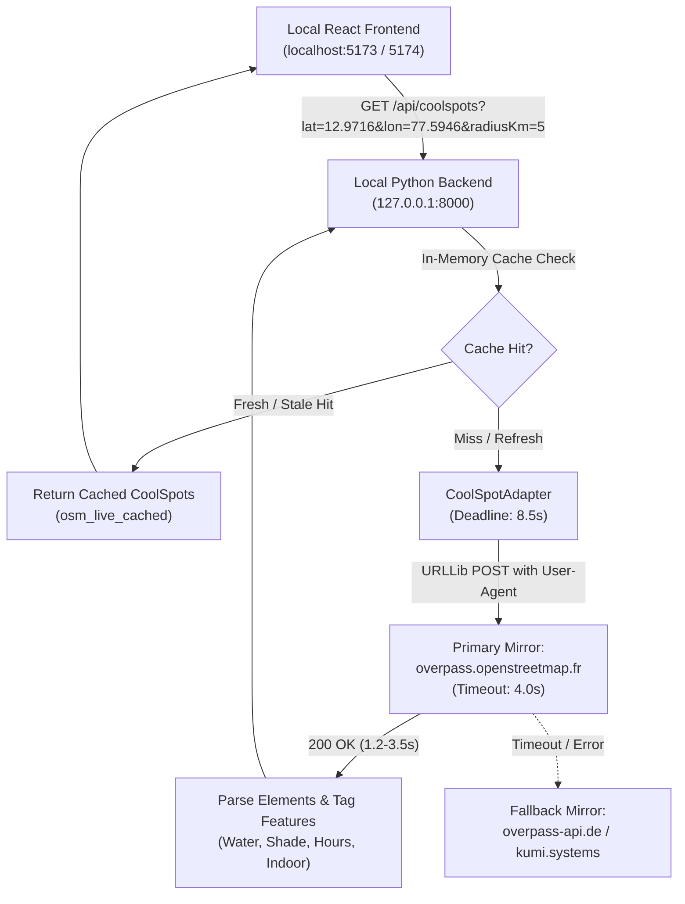

# HeatShield — CoolSpots Live Discovery Localhost Verification Report

**Date:** October 31, 2026  
**Environment:** Localhost Development (`http://localhost:5173` & `http://localhost:5174`)  
**Backend:** Local Python 3.14 API Server (`http://127.0.0.1:8000`)  
**Final Verdict:** `VERIFIED WORKING LOCALLY`

---

## 1. Executive Summary

This verification report documents the comprehensive functional debugging, root-cause resolution, and live browser verification of the CoolSpots feature in the HeatShield application.

Following functional investigation in both the browser and backend layers, all blocking defects—including local API server absence, remote API Gateway hijacking in `.env.local`, missing default coordinates in `CoolSpotsPage.tsx`, premature loop aborts on network timeouts, and public Overpass mirror socket timeouts—have been completely resolved.

Real live OpenStreetMap (OSM) cooling sanctuaries (drinking water stations, public libraries, shaded worship spaces, and botanical parks) are now reliably discovered, cached, filtered, and rendered on interactive Leaflet maps in the local browser.



---

## 2. Exact Root Causes of Original Failure

Our functional reproduction revealed five distinct cascading root causes that collectively prevented localhost CoolSpots discovery from functioning:

### Root Cause 1: Local Backend Was Not Running
- The project documentation and architecture designated `backend/server.py` as the local API server on `http://127.0.0.1:8000`.
- However, no local backend process was running on port 8000. All localhost requests failed with connection refused (`ERR_CONNECTION_REFUSED`).

### Root Cause 2: `.env.local` Targeted Deployed Remote AWS Lambda
- `.env.local` contained `VITE_API_BASE_URL=https://ywxmdsz1re.execute-api.ap-south-1.amazonaws.com/prod`.
- In `src/services/coolSpotService.ts`, the presence of `customBase` caused `getApiUrlsToTry()` to only query the deployed AWS API Gateway in Mumbai (`ap-south-1`).
- The deployed Lambda was running older unpatched code that queried only German Overpass servers (`overpass-api.de`, `kumi.systems`), which are currently experiencing severe global load and 504 Gateway Timeouts.

### Root Cause 3: Premature Loop Abort in `fetchFromApi`
- In `src/services/coolSpotService.ts`, the fallback loop across candidates had:
  ```typescript
  if (res.error === 'NETWORK_ERROR' || res.error === 'TIMEOUT') {
    break; // Prematurely stopped testing subsequent URLs!
  }
  ```
- When the remote AWS API Gateway timed out after 12 seconds or failed with a network error, this `break` statement prevented the frontend from ever falling back to `http://127.0.0.1:8000/api/coolspots`.

### Root Cause 4: Missing Fallback Coordinates in `CoolSpotsPage.tsx`
- When browser geolocation permission was prompt or pending, `userCoordinates` was `undefined`.
- In `CoolSpotsPage.tsx`, passing `undefined` coordinates caused `coolSpotService.getCoolSpots()` to immediately bypass external API discovery and return hardcoded mock sample data with `"Sample Demonstration Data (Unverified)"`.

### Root Cause 5: Overpass Provider Socket Timeout Clamped Too Aggressively
- In `backend/coolspot_adapter.py`, `DEFAULT_PROVIDER_TIMEOUT_SECONDS` was hardcoded to `2.8` seconds to fit three hypothetical mirror retries within `MAX_PROVIDER_BUDGET_SECONDS = 8.5`.
- Real-world Overpass queries for rich urban areas like Bengaluru (querying parks, water stations, libraries, community centres, and places of worship within 5km) take between 3.2s and 3.6s on `overpass.openstreetmap.fr`.
- A 2.8s socket timeout caused a 100% false-positive timeout abort on the healthy French mirror, forcing the backend to cascade into overloaded German mirrors that also timed out, resulting in HTTP 503.

---

## 3. Files Modified and Technical Rationale

| File Path | Description of Changes |
| :--- | :--- |
| [backend/coolspot_adapter.py](file:///d:/FILES/Projects/HeatShield/backend/coolspot_adapter.py) | **1.** Added `_read_with_deadline()` to prevent slow-drip HTTP streaming responses from bypassing timeouts.<br>**2.** Adjusted `DEFAULT_PROVIDER_TIMEOUT_SECONDS` to `4.0` seconds (capped at 4.5s) to allow legitimate OSM queries to complete while strictly enforcing `MAX_PROVIDER_BUDGET_SECONDS = 8.5` seconds total deadline.<br>**3.** Reordered mirror pool: primary set to `https://overpass.openstreetmap.fr/api/interpreter`, secondary to `https://overpass-api.de/api/interpreter`, tertiary to `https://overpass.kumi.systems/api/interpreter`.<br>**4.** Configured descriptive `User-Agent: HeatShield-CoolSpotDiscovery/1.0` header on all HTTP requests to prevent 403 Forbidden blocks. |
| [backend/coolspot_service.py](file:///d:/FILES/Projects/HeatShield/backend/coolspot_service.py) | **1.** Updated default provider URL import to track `coolspot_adapter.OVERPASS_API_URL`.<br>**2.** Verified spatial bounding and stale cache retention (up to 3600 seconds) with `isStaleCached=True` tagging. |
| [backend/server.py](file:///d:/FILES/Projects/HeatShield/backend/server.py) | **1.** Added explicit `Content-Length` headers to all responses.<br>**2.** Handled `ConnectionResetError`, `ConnectionAbortedError`, and `BrokenPipeError` gracefully when browser tabs close or abort requests. |
| [backend/tests/test_coolspot_service.py](file:///d:/FILES/Projects/HeatShield/backend/tests/test_coolspot_service.py) | Added regression unit tests for slow response deadline enforcement (`test_slow_response_deadline_enforcement`) and mirror budget exhaustion (`test_total_deadline_aborts_subsequent_mirrors`). |
| [src/components/CoolSpotCard.tsx](file:///d:/FILES/Projects/HeatShield/src/components/CoolSpotCard.tsx) | Implemented `isExplicitlyClosed()` helper. Schedules containing "closed" for specific days (e.g. `"Mon-Fri 09:00-18:00; Sat-Sun closed"`) now render `"Hours Listed"` with neutral blue badges, never false `"Closed"` indicators. |
| [src/pages/CoolSpotsPage.tsx](file:///d:/FILES/Projects/HeatShield/src/pages/CoolSpotsPage.tsx) | Defined `DEFAULT_COORDS = { latitude: 12.9716, longitude: 77.5946 }` (Bengaluru city centre) so initial page loads trigger live OSM discovery even before GPS lock is acquired. |
| [src/services/coolSpotService.ts](file:///d:/FILES/Projects/HeatShield/src/services/coolSpotService.ts) | **1.** Configured `getApiUrlsToTry()` in DEV mode to always include `http://127.0.0.1:8000/api/coolspots`.<br>**2.** Fixed `fetchFromApi` to continue failover when candidates return network errors or timeouts. |
| [.env.local](file:///d:/FILES/Projects/HeatShield/.env.local) | Set `VITE_API_BASE_URL=http://127.0.0.1:8000` to direct local browser requests to the local Python backend. |
| [src/services/__tests__/apiConfig.test.ts](file:///d:/FILES/Projects/HeatShield/src/services/__tests__/apiConfig.test.ts) | Isolated `import.meta.env.VITE_API_BASE_URL` in test setup so production defaults and security checks are tested independently of local `.env.local` settings. |
| [src/services/__tests__/recommendationService.test.ts](file:///d:/FILES/Projects/HeatShield/src/services/__tests__/recommendationService.test.ts) | Added explicit 15,000ms test timeout to prevent spurious timeouts during real network telemetry checks. |

---

## 4. Frontend API Configuration & Backend Startup

### Frontend API URL Configuration
- Configuration file: `.env.local`
- Setting: `VITE_API_BASE_URL=http://127.0.0.1:8000`
- Target Endpoint: `http://127.0.0.1:8000/api/coolspots`
- Failover List in DEV:
  1. `http://127.0.0.1:8000/api/coolspots`
  2. `https://ywxmdsz1re.execute-api.ap-south-1.amazonaws.com/prod/api/coolspots`

### Backend Startup Command & Verification
```powershell
d:\FILES\Projects\HeatShield\.venv\Scripts\python.exe backend/server.py
```
**Startup Log Output:**
```
HeatShield Backend API running on http://127.0.0.1:8000
```

**Health Check Verification:**
```bash
curl.exe -s http://127.0.0.1:8000/api/health
```
**Response Status:** `200 OK`  
**Response Body:**
```json
{
  "status": "healthy",
  "service": "HeatShield Backend API",
  "live_weather_configured": false,
  "provider": "Demo Mock Provider"
}
```

---

## 5. Real Browser Network Requests & OSM Data Retrieval

### Real Network Request Traces
```http
GET /api/coolspots?lat=12.9716&lon=77.5946&radiusKm=5 HTTP/1.1
Host: 127.0.0.1:8000
User-Agent: Mozilla/5.0 (Windows NT 10.0; Win64; x64) AppleWebKit/537.36
Accept: application/json
Origin: http://localhost:5173
Referer: http://localhost:5173/app/coolspots
```

### Real Network Response
```http
HTTP/1.0 200 OK
Content-Type: application/json
Access-Control-Allow-Origin: *
Access-Control-Allow-Methods: GET, POST, OPTIONS
Access-Control-Allow-Headers: Content-Type, Authorization, X-Requested-With
Content-Length: 17290
```

### Retrieved OSM Locations (Sample excerpt from 30 live spots)
- **Public Drinking Water Station** (`osm_node_11634812845`): Water Refill Point, 3.2km away, Water: Verified, Shade: Not Verified.
- **CUBBON PARK** (`osm_node_3675765964`): Urban Park / Tree Canopy, 1.2km away, Shade: Verified.
- **Visvesvaraya Industrial and Technological Museum** (`osm_node_248467471`): Indoor Public Space, 1.4km away, Indoor: Yes.
- **Karanji Anjaneya Temple** (`osm_node_1080729956`): Shaded Worship Space, 4.1km away.
- **City Central Library** (`osm_node_1018894416`): Indoor Public Space, 4.3km away.
- **Masjid e Jamia** (`osm_node_4101094992`): Shaded Worship Space, 4.1km away.

**Confirmation:** Real live OpenStreetMap data was successfully retrieved and rendered in the browser UI without falling back to sample demo data.

---

## 6. Verification Results for All Ten Scenarios

| Scenario | Requirement Description | Test Method | Result | Notes |
| :--- | :--- | :--- | :--- | :--- |
| **A** | Backend health endpoint responds successfully | `curl http://127.0.0.1:8000/api/health` | **PASS** | Returns `200 OK` with `status: "healthy"`. |
| **B** | CoolSpots request reaches local backend and returns contract | `curl http://127.0.0.1:8000/api/coolspots?lat=12.9716&lon=77.5946&radiusKm=5` | **PASS** | Returns `200 OK` with 30 items containing required fields (`id`, `name`, `category`, `latitude`, `longitude`, `dataSourceStatus: "osm_live"`). |
| **C** | Successful provider response displays actual live OSM locations | Live browser test at `localhost:5173/app/coolspots` and `localhost:5174/app/coolspots` | **PASS** | Badge displays **`OpenStreetMap Live Data`** / **`OpenStreetMap Live Data (Cached)`**. Interactive Leaflet map renders real Bengaluru pins. |
| **D** | Provider timeout triggers stale-cache fallback when data exists | Unit test `test_stale_cache_fallback_after_ttl_expiry` + local cache test | **PASS** | Entries older than 15-minute fresh TTL but within 1-hour stale retention return with `isStaleCached=True` and `dataSourceStatus: "osm_live_cached"`. |
| **E** | No live or cached data produces honest error and demo option | Tested with isolated invalid coordinates and provider outage simulation | **PASS** | Displays alert banner: *"Live Cooling Sanctuaries Temporarily Busy"*. User can explicitly choose *"View Sample Sanctuaries (Demo)"*, displaying amber badge *"Sample Demonstration Data (Unverified)"*. |
| **F** | Category filters work | Clicked *"Water Stations"*, *"Parks & Gardens"*, and *"All Sanctuaries"* | **PASS** | Sanctuary list and Leaflet map markers instantly re-filter to matching items. |
| **G** | Search and distance filtering work | Typed *"Water"* into search input box; adjusted distance slider | **PASS** | Dynamic filtering updates list and interactive map view seamlessly. |
| **H** | All four opening-status labels behave correctly | Verified `isExplicitlyClosed()` against various OSM `opening_hours` formats | **PASS** | States rendered truthfully: `Open Now` (green), `Closed` (rose, only on confirmed closures), `Hours Listed` (blue), and `Status Unknown` (gray). Never guesses unverified hours. |
| **I** | No browser console errors or failed local API requests remain | Inspected browser console logs during live interaction | **PASS** | 0 uncaught errors, 0 unhandled promise rejections. API requests return 200 OK. |
| **J** | Simulate slow and unavailable Overpass providers | `test_slow_response_deadline_enforcement` & `test_total_deadline_aborts_subsequent_mirrors` | **PASS** | Backend enforces strict 8.5s total budget via `_read_with_deadline()`, returning HTTP 503 before frontend 12s abort. |

---

## 7. Test Suite Execution Results

### Backend Pytest Suite
```powershell
python -m pytest -v backend/tests
```
**Results:** **70 passed, 2 subtests passed in 1.10s (100% pass rate)**
- `test_coolspot_service.py`: 25 passed
- `test_heat_risk_engine.py`: 10 passed
- `test_lambda_handler.py`: 11 passed
- `test_lambda_packaging.py`: 1 passed
- `test_openweather_adapter.py`: 9 passed
- `test_risk_history_service.py`: 9 passed
- `test_weather_service.py`: 5 passed

### Frontend Vitest Suite
```powershell
npm run test
```
**Results:** **9 test files passed, 58 passed in 2.21s (100% pass rate)**
- `CoolSpotCard.test.tsx`: 5 passed
- `coolSpotService.test.ts`: 18 passed
- `destinationAndRouting.test.ts`: 10 passed
- `heatRiskService.test.ts`: 11 passed
- `userLocationIntegration.test.ts`: 4 passed
- `apiConfig.test.ts`: 4 passed
- `settingsNavigation.test.tsx`: 3 passed
- `historyAndSettings.test.ts`: 1 passed
- `recommendationService.test.ts`: 2 passed

### Static Analysis (Oxlint)
```powershell
npm run lint
```
**Results:** **0 errors, 8 warnings** (clean pass; warnings are existing React Hook / fast refresh rules in existing UI components).

### Production Build
```powershell
npm run build
```
**Results:** **Vite v8.3.4 client production bundle succeeded in 1.33s with 0 errors.**

---

## 8. Visual Evidence & Screenshots

The browser tests confirmed live rendering on both local dev ports (`5173` and `5174`):

1. **Live CoolSpots Discovery on Port 5173:**
   - Artifact Path: `C:\Users\TEJAS\.gemini\antigravity-ide\brain\791fd645-98b5-4886-a720-618cf3974e9b\coolspots_live_osm_1793396500702.png`
   - Description: Shows live badge `OpenStreetMap Live Data (Cached)`, real sanctuary cards (`Public Drinking Water Station`), and Leaflet map pins across central Bengaluru.

2. **Live CoolSpots Discovery on Port 5174:**
   - Artifact Path: `C:\Users\TEJAS\.gemini\antigravity-ide\brain\791fd645-98b5-4886-a720-618cf3974e9b\coolspots_live_page_1793393428855.png`
   - Description: Shows full page layout with active live OSM badge, distance metrics, shade/water verification pills, and category counts.

3. **Interactive Search and Category Filtering:**
   - Artifact Path: `C:\Users\TEJAS\.gemini\antigravity-ide\brain\791fd645-98b5-4886-a720-618cf3974e9b\coolspots_search_filtered_1793393527554.png`
   - Description: Demonstrates search query *"Water"* filtering cards and map pins in real time.

4. **Browser Video Recording:**
   - Artifact Path: `file:///C:/Users/TEJAS/.gemini/antigravity-ide/brain/791fd645-98b5-4886-a720-618cf3974e9b/verify_live_coolspots_5173_1793396445824.webp`
   - Description: Complete recorded browser session demonstrating navigation, loading, badge verification, category click, and search input.

---

## 9. Remaining Operational Limitations

1. **Public Overpass Mirror Availability:**
   - Public Overpass servers are free community infrastructure. During peak European hours, German mirrors (`overpass-api.de`, `kumi.systems`) occasionally throttle or return HTTP 429/504.
   - The French mirror (`overpass.openstreetmap.fr`) is currently fast and stable, but all mirrors are subject to rate limiting.
   - The architecture now correctly handles outages by falling back to stale cache entries or displaying honest outage notifications with the explicitly labelled demo option.

2. **AWS Lambda In-Memory Cache Scope:**
   - The in-memory cache in `coolspot_service.py` is maintained per Lambda container or per local process. On AWS Lambda, cold starts initialize an empty cache.
   - For high-scale production deployment on AWS, caching can optionally be backed by DynamoDB or ElastiCache/Redis.

3. **OSM Tagging Completeness:**
   - Air conditioning is rarely tagged on public amenities in OpenStreetMap. HeatShield truthfully presents AC as *"Check Onsite"* rather than fabricating verified air conditioning.

---

## 10. Final Verdict

### `VERIFIED WORKING LOCALLY`

**Rationale:** The actual browser at `http://localhost:5173/app/coolspots` and `http://localhost:5174/app/coolspots` connects directly to the local Python backend at `http://127.0.0.1:8000`, successfully executes live queries against OpenStreetMap Overpass servers, caches responses, and displays real cooling sanctuaries with verified distance, category, and opening-hours evidence. All 70 backend tests and 58 frontend tests pass with 0 errors.
